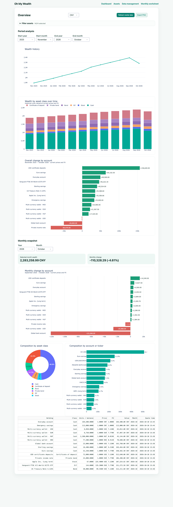
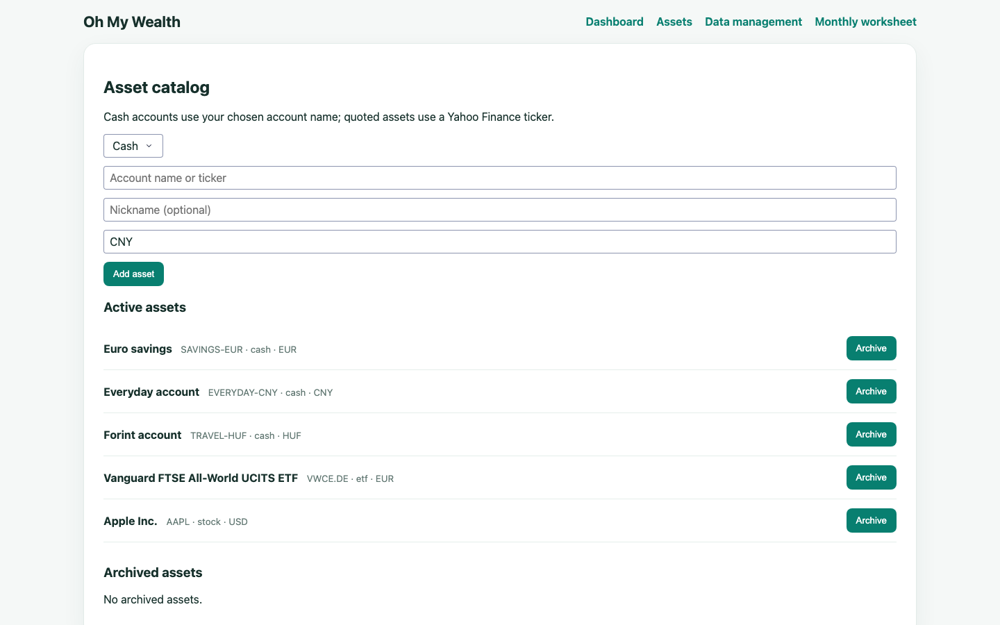
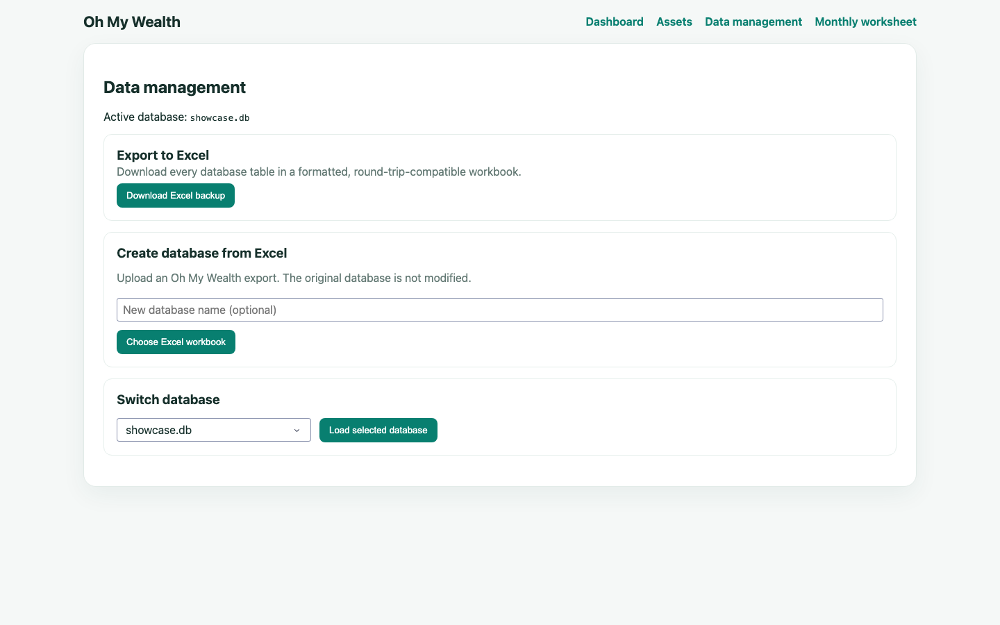

# Oh My Wealth

A private, local wealth dashboard built with Dash, Plotly, SQLite, SQLAlchemy,
yfinance, and a public US bond quote adapter. It tracks monthly cash balances
and quoted assets, then values every month at current prices and FX rates.

Supported currencies are CNY, HUF, USD, EUR, GBP, and HKD.

## Showcase

### Dashboard



### Asset catalog



### Excel backup and database selection



## Run

```bash
uv sync
uv run ohmywealth
```

Open <http://127.0.0.1:8050>. Data is stored in `.ohmywealth/wealth.db`; set
`OHMYWEALTH_DB_PATH` to use a different SQLite file.
The local launcher enables Dash debug mode, so source and stylesheet changes
automatically reload the development server.

To preview a sample portfolio in an empty database, run `uv run ohmywealth-demo`.
The command never changes a database that already contains assets.

Use **Assets** to add cash accounts, Yahoo Finance tickers, bonds by ISIN, or US
bonds by CUSIP. ISIN reference data is resolved through OpenFIGI; public US bond
prices use the bond quote adapter. Unlisted OTC bonds and certificates of
deposit may have reference data but no public price, in which case the app shows
an explicit warning rather than inventing a value. In the **Monthly worksheet**,
enter cash balances, stock/ETF units, or the face value of bonds. A new month
starts from the latest preceding snapshot. The dashboard defaults to CNY and
marks stale cached quotes when a provider is unavailable.

The Overview selector is a three-level checkbox tree: asset class, account
currency, and individual account. Selecting a parent checks its real child
accounts; individual children can then be excluded. Parent checks automatically
reflect whether all descendants remain selected, and `All assets` restores the
full portfolio.

The dashboard includes a diverging monthly-change chart for every account whose
value changed between the latest two completed snapshots. Positive and negative
bars reconcile to the total Monthly change and use current prices and FX, just
like the wealth-history calculation.

An Overall change by account chart uses the dashboard's selected start and end
period. It compares the first and last available snapshots inside that range,
omits unchanged accounts, and uses the same current-price/current-FX valuation.

The dashboard places period analysis first. A separate Monthly snapshot section
below it has year and month selectors that default to the latest month containing
data. Its wealth, change, account-change chart, compositions, and holdings table
all update to the selected snapshot and compare it with the preceding snapshot.
The holdings table shows both the selected snapshot month and the timestamp of
the current market price/FX data used for valuation.

Monthly snapshots are month-end balances. History charts therefore place each
point on the actual last calendar day of its month and label the X axis by month;
the database's first-of-month date remains only an internal normalized key.
Separate year and month selectors for the start and end change the inclusive
period shown by both history charts. Years come from existing snapshot data and
months use a fixed 12-item list, so the controls stay short as data accumulates.
Current-wealth and composition metrics are unchanged.

Ordinary bond prices are percentages of par. For example, face value `10,000`
at a quote of `100.266` is valued at `10,026.60` before currency conversion.
Certificates of deposit are shown as a separate asset class and use the current
amount entered each month, with no market quote or ISIN required. Create one
stable account per institution and currency, such as `HSBC CD Account` in USD,
then enter the aggregate account value each month. Renewing its underlying
certificates does not create more assets.
Unlisted non-CD instruments are classified as private bonds and likewise use
the current statement amount entered each month.

Assets can have an optional nickname. Quoted assets retain their official
provider name and display it as `Official name (Nickname)`.

Archiving hides an asset from new worksheets while preserving its historical
positions. Restore it at any time from **Assets → Archived assets**.

Use **Data management** to export every database table to an Excel workbook,
import an exported workbook as a new database, or switch between local `.db`
files. Imported workbooks never overwrite the active database.

## Documentation

- [Documentation index](docs/README.md)
- [Architecture and database design](docs/design.md)

## Development

The code uses a four-layer architecture. Dependencies point inward: financial
rules know nothing about databases or Dash, and the application layer works
through replaceable interfaces.

```text
src/ohmywealth/
├── domain/                 # Financial models and pure valuation rules
│   ├── models.py
│   ├── identifiers.py       # ISIN/CUSIP validation and normalization
│   └── valuation.py
├── application/            # Use cases and adapter interfaces
│   ├── ports.py             # Repository and market-data protocols
│   ├── market.py            # Cache and provider-fallback workflow
│   ├── snapshots.py         # Monthly copy/save workflow
│   └── reporting.py         # Current and historical portfolio reports
├── infrastructure/         # External system adapters
│   ├── database.py          # SQLAlchemy models and schema migration
│   ├── database_catalog.py  # Safe discovery and persisted DB selection
│   ├── excel.py             # Formatted Excel export and validated import
│   ├── repository.py        # SQLite repositories and market cache
│   ├── bonds.py             # Public US bond quotes by ISIN/CUSIP
│   ├── market_data.py       # Provider routing by identifier
│   ├── yahoo.py             # yfinance provider
│   └── demo.py              # Idempotent preview-data seeder
├── presentation/           # Dash-only UI code
│   ├── app.py               # Application factory and navigation
│   ├── figures.py           # Plotly figure factories
│   ├── runtime.py           # Page dependency wiring
│   ├── pages/               # Auto-discovered page layouts and callbacks
│   └── assets/style.css
├── __main__.py             # `ohmywealth` launcher
└── demo.py                 # `ohmywealth-demo` launcher
docs/design.md              # Architecture, schema, and workflow specification
tests/                      # Focused domain, workflow, DB, and smoke tests
```

### Extension points

- Add a dashboard page by placing a module containing `dash.register_page`, a
  layout, and its callbacks in `presentation/pages/`. Dash discovers it on
  startup and adds it to navigation automatically.
- Add a visualization as a figure factory in `presentation/figures.py`, then
  call it from its owning page.
- Replace a quote source by implementing `MarketDataProvider` from
  `application/ports.py` and changing the routed adapter created in
  `presentation/runtime.py`.
- Replace persistence by implementing `WealthRepository` and `MarketCache`.
  Application and domain code do not import SQLAlchemy or Dash.
- Add schema changes in `infrastructure/database.py` and increment the stored
  schema version. Migrations run when the application opens the database.

### Local workflow

Install locked runtime and development dependencies:

```bash
uv sync
```

Run the checks:

```bash
uv run pytest
uv run ruff check .
```

The test suite intentionally concentrates on valuation, snapshot updates,
cached-provider fallback, persistence/migration behavior, and application/page
startup rather than browser automation.
